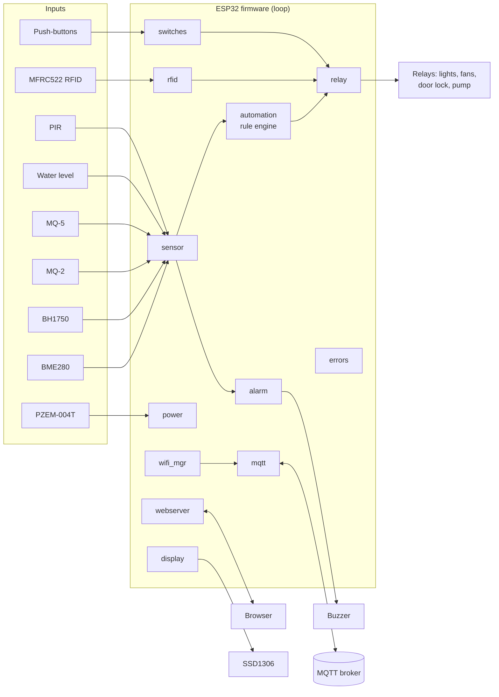

# ESP32 Smart Home Automation

[](https://github.com/MohansaiPotnuru/SmartHomeAutomation/actions/workflows/build.yml)

Modular ESP32 firmware for a home automation node. In one non-blocking loop it handles:

- environment sensing,
- gas, smoke and water safety alarms,
- PIR intrusion detection,
- RFID door access,
- mains energy metering,
- an OLED status display, a local web dashboard and MQTT control,
- physical override buttons that keep working when Wi-Fi is down.

## Features

| Area | What it does |
|---|---|
| **Environment** | BME280 temperature / humidity / pressure / altitude, BH1750 ambient light |
| **Safety** | MQ-2 smoke and MQ-5 LPG/gas alarms, water-overflow alarm, automatic ventilation (Fan 1 forced on during smoke/gas) |
| **Climate** | Fan 1 auto-control with hysteresis: ON above 35 °C, OFF below 32 °C |
| **Lighting** | Auto night-light: Light 1 turns on below 100 lux |
| **Water** | Pump auto-starts when the tank is low and stops when it is full |
| **Security** | Arm/disarm (persisted in NVS), PIR intrusion alarm, RFID door lock with Admin/User/Guest roles, 5-strike 30 s reader lockout, 5 s auto-relock |
| **Energy** | PZEM-004T v3: voltage, current, power, kWh, frequency, power factor, mains-loss events |
| **Interfaces** | MQTT (commands + retained state), web dashboard + JSON API (Basic Auth), SSD1306 OLED with 4 rotating pages, 4 manual push-buttons |
| **Robustness** | Non-blocking Wi-Fi/MQTT reconnect, task watchdog, per-sensor feature flags, central fault reporting (`home/system/error`) |

Alarms are edge-triggered. Each one publishes once when it trips and once when it clears. The retained `home/alarm/state` topic always holds the current state.

## Architecture



| Module | Responsibility |
|---|---|
| `SmartHomeAutomation.ino` | `setup()` / `loop()`, watchdog, scheduling |
| `config.h` / `pins.h` | Thresholds, timings, MQTT topics, feature flags / all GPIO assignments |
| `secrets.h` | Wi-Fi, MQTT and web credentials, default RFID cards (copy from `secrets.example.h`) |
| `relay` | Actuator control. Tracks whether a relay was switched by automation or manually, so rules never fight a manual override |
| `sensor` | Reads and publishes every sensor, raises/clears safety alarms |
| `automation` | Rule engine: climate, lighting, pump, intrusion, plus the armed state |
| `alarm` | Non-blocking buzzer and edge-triggered alarm state machine |
| `rfid` | MFRC522 card access; cards and roles stored in NVS |
| `power` | PZEM-004T energy monitoring |
| `wifi_mgr` / `mqtt` | Non-blocking connection managers, command dispatch, safe publish helpers |
| `webserver` | Dashboard at `/`, actions at `/control`, JSON at `/api/status` |
| `display` | OLED pages: status, environment, safety, power |
| `switches` | Debounced manual toggles for Light 1, Light 2, Fan 1 and the door |
| `errors` | Aggregates sensor/network faults into one retained status string |

## Hardware & wiring

`pins.h` is the authoritative list.

| Function | GPIO | Notes |
|---|---|---|
| Light 1 / Light 2 relay | 13 / 14 | Relay modules are active-LOW |
| Fan 1 / Fan 2 relay | 16 / 17 | |
| Door lock relay | 21 | |
| Water pump relay | 25 | |
| Buzzer | 27 | |
| I²C SDA / SCL | 32 / 33 | Shared by BME280 (0x76/0x77), BH1750, SSD1306 (0x3C) |
| PIR | 26 | |
| MQ-2 smoke / MQ-5 gas / water level | 34 / 36 / 35 | ADC1 only, so they still work with Wi-Fi on |
| RFID SPI: SCK / MISO / MOSI | 18 / 19 / 23 | Default VSPI bus |
| RFID SS / RST | 5 / 22 | |
| PZEM-004T RX / TX (Serial2) | 4 / 2 | GPIO2 is a strapping pin: don't pull it externally at boot |
| Button: Light 1 / Light 2 / Fan 1 / Door | 12 / 39 / 0 / 15 | Buttons go to GND. **GPIO39 needs an external 10 kΩ pull-up to 3V3.** GPIO0 is also the BOOT button. Don't hold 0/12/15 down during power-up |

> **Analog sensors:** MQ-2/MQ-5 modules and many water-level sensors output 0–5 V. The ESP32 ADC tops out at about 3.3 V, so use a voltage divider.

### Libraries (Arduino Library Manager)

`PubSubClient`, `MFRC522`, `Adafruit BME280 Library`, `Adafruit Unified Sensor`, `BH1750` (claws), `PZEM004Tv30` (Jakub Mandula), `Adafruit SSD1306`, `Adafruit GFX Library`.

Board package: **esp32 by Espressif Systems**. CI builds against both **2.0.x and 3.x** cores.

## Getting started

1. Copy `secrets.example.h` to `secrets.h` and fill in your Wi-Fi, MQTT broker, dashboard login and RFID card UIDs. To find a card's UID, scan it once and read the `[RFID] Scanned UID:` line in the serial monitor.
2. If a module isn't wired yet, set its flag in `config.h` to `0` (for example `#define FEATURE_PZEM 0`). The rest of the system keeps running.
3. Select **ESP32 Dev Module**, upload, and open the serial monitor at 115200 baud.
4. Browse to the IP address printed by `[WIFI] Connected!` and log in with the dashboard credentials.

On first boot the cards in `DEFAULT_CARDS` are written to NVS. After that the list is ignored unless you call `rfid_factoryReset()`.

Or from the command line:

```sh
arduino-cli compile --fqbn esp32:esp32:esp32 .
arduino-cli upload  --fqbn esp32:esp32:esp32 -p /dev/ttyUSB0 .
```

## MQTT API

**Commands** (the node subscribes to these):

| Topic | Payload |
|---|---|
| `home/light1`, `home/light2`, `home/fan1`, `home/fan2`, `home/pump` | `ON` / `OFF` |
| `home/door` | `UNLOCK` / `LOCK` |
| `home/arm` | `ON` / `OFF` (also `TRUE` / `FALSE`) |

**State** (retained): `home/<device>/state` for every device above, plus `home/status` (`online`/`offline` via LWT), `home/alarm/state` (`CLEAR`, `SMOKE`, `GAS`, `WATER`, `MOTION`) and `home/system/error` (`OK` or a list such as `BME280,PZEM`).

**Telemetry:** `home/env/{temperature,humidity,pressure,altitude,lux}`, `home/safety/{smoke,gas,waterlevel}`, `home/security/{motion,rfid}`, `home/power/{voltage,current,watts,energy_kwh,frequency,powerfactor}`.

**Events:** `home/alarm` (transient alarm messages), `home/system/log` (door, RFID, pump and power events).

```sh
mosquitto_pub -h <broker> -t home/light1 -m ON
mosquitto_sub -h <broker> -t 'home/#' -v
```

## Web dashboard

| Route | Description |
|---|---|
| `GET /` | Status page with toggle buttons. Refreshes every 5 s |
| `GET /control?d=<light1\|light2\|fan1\|pump\|door\|arm>&s=<on\|off\|unlock\|lock>` | Actuator control, then redirects to `/` |
| `GET /api/status` | JSON snapshot. Missing sensors are reported as `null` |

All routes need HTTP Basic Auth (`WEB_ADMIN_USER` / `WEB_ADMIN_PASS`).

## Security notes

- MQTT has no TLS, and authentication is optional. `home/door` and `home/arm` can unlock the door and disarm the system, so use broker credentials and ACLs. Keep the broker on a trusted LAN or behind TLS/VPN.
- The dashboard uses HTTP Basic Auth without TLS. That's fine on a private LAN, but don't port-forward it to the internet.
- The RFID lockout slows brute-force attempts. It won't stop someone with physical access, and MIFARE Classic UIDs can be cloned.

## Changelog

**v2.1**
- **Fixed an SPI pin clash.** The manual buttons were on GPIO18/19/23, which are the RFID reader's SCK/MISO/MOSI lines. Setting them to `INPUT_PULLUP` broke the RFID bus. The buttons now use GPIO12/39/0/15.
- **Fixed an MQTT feedback loop.** Relay state was published (retained) to the same topic the node subscribes to for commands. Every change came straight back as a "manual" command, which also cancelled the automation's auto-off. State now goes to `home/<device>/state`.
- **Water alarm:** the overflow alarm has its own threshold (`WATER_OVERFLOW_THRESH`). Before, it fired every time the pump normally filled the tank to `WATER_FULL_THRESH`.
- **Arm command:** `home/arm` now ignores unknown payloads. Before, any typo disarmed the system.
- **RFID fault detection:** a missing MFRC522 now sets the `RFID` fault flag.
- **JSON API:** `/api/status` now outputs `null` instead of the invalid `nan`, and includes more fields.
- **Arduino-ESP32 core 3.x support:** the task watchdog API changed.
- **New files:** `secrets.example.h`, so a fresh clone compiles. `wifi.h` was renamed to `wifi_mgr.h` to avoid a case-insensitive clash with the core's `WiFi.h`.
- **New CI** compiles against ESP32 cores 2.0.17 and 3.1.1.

**v2.0** – Split the single-file sketch into modules. Added BME280, BH1750, MQ-5, PZEM-004T, OLED, the web dashboard, manual switches and multi-card RFID, plus non-blocking networking and hysteresis.

## Author

**P. Mohan Sai** – [GitHub](https://github.com/MohansaiPotnuru)
